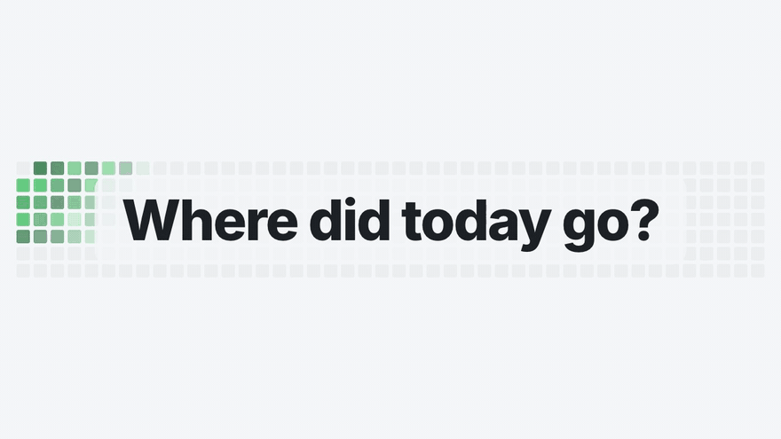
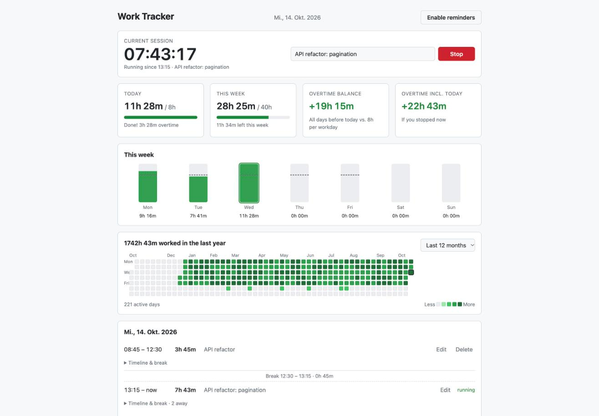
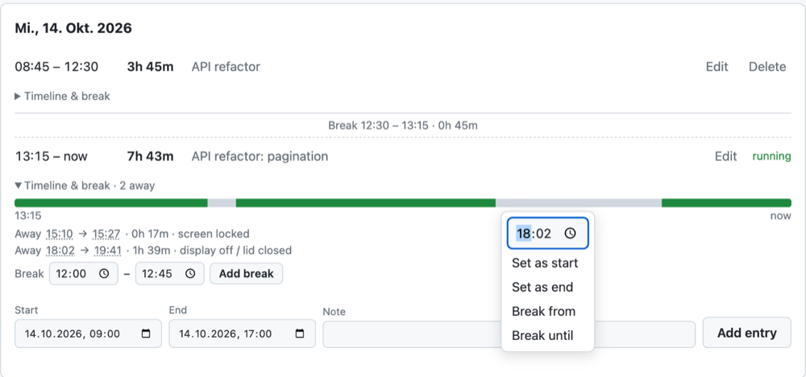
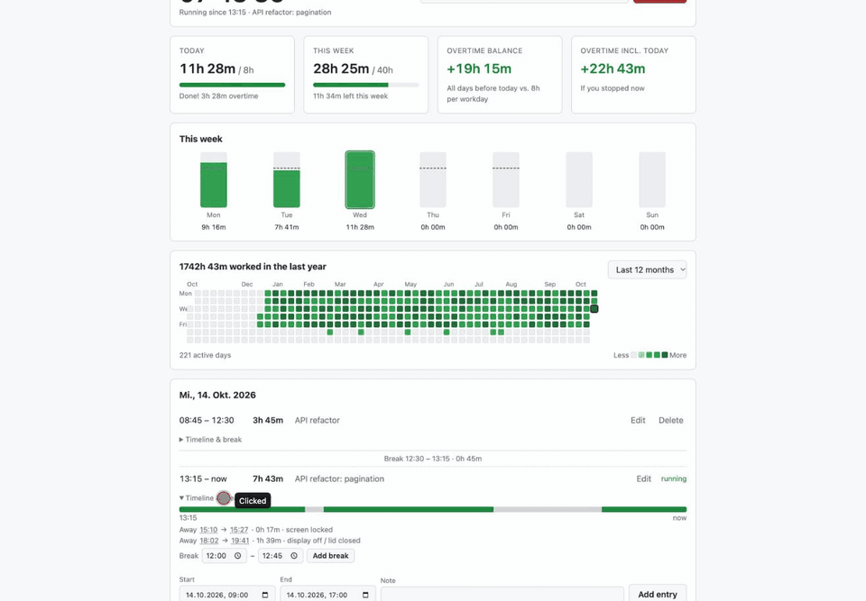
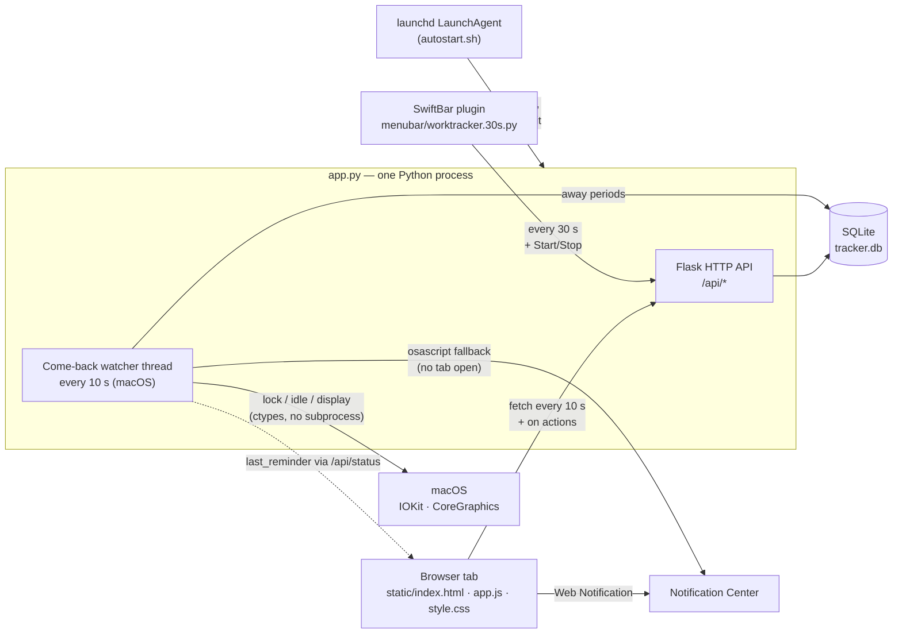

<h1 align="center">Work Tracker</h1>

<p align="center"><b>Your GitHub contribution graph — but for your working day.</b></p>

<p align="center">
  <a href="docs/work-tracker.mp4"></a>
</p>

<p align="center">
  <a href="#quick-start">Quick start</a> ·
  <a href="#tutorial">Tutorial</a> ·
  <a href="#architecture">Architecture</a> ·
  <a href="#performance--footprint">Performance</a> ·
  <a href="docs/work-tracker.mp4">Video (MP4)</a>
</p>

A small, self-hosted work-time tracker. Start and stop a timer, see how much you've worked today and
this week against an 8 h / 40 h target, keep an overtime balance, and browse your history in a
GitHub-style heatmap. On macOS it can also start at login, remind you to start the timer when you
come back to your laptop, and live in the menu bar.

Everything runs locally: one Python process, one SQLite file, no accounts, no cloud.

## Table of contents

- [Features](#features)
- [Quick start](#quick-start)
- [Tutorial](#tutorial)
  1. [Track your time](#1-track-your-time)
  2. [Read your stats](#2-read-your-stats)
  3. [Fix and add entries (day view)](#3-fix-and-add-entries-day-view)
  4. [Add a lunch break](#4-add-a-lunch-break)
  5. [Forgot to stop the timer? Use the timeline](#5-forgot-to-stop-the-timer-use-the-timeline)
  6. [Come-back reminders (macOS)](#6-come-back-reminders-macos)
  7. [Menu bar item (macOS)](#7-menu-bar-item-macos)
  8. [Start at login (macOS)](#8-start-at-login-macos)
- [Configuration](#configuration)
- [Architecture](#architecture)
- [Tech stack](#tech-stack)
- [Performance & footprint](#performance--footprint)
- [Troubleshooting](#troubleshooting)
- [Project layout](#project-layout)
- [Uninstall](#uninstall)

---

## Features

| | Feature | Platforms |
|---|---|---|
| ⏱ | **Timer** with a note of what you're working on (editable while it runs) | all |
| 📊 | **Today / This week** vs. target, time left, when you'll be done | all |
| ⚖️ | **Overtime balance** (days before today) and **overtime incl. today** (“if you stopped now”) | all |
| 🟩 | **Activity heatmap** for the last 12 months or any year | all |
| ✏️ | **Day view**: add, edit, delete sessions; **breaks** (e.g. lunch) that don't count as work | all |
| 🕒 | **Timeline per session**: when the Mac was in use vs. away; click any time to use it as start, end or break | all¹ |
| 🔔 | **Come-back reminder**: notification when you return to the Mac and no timer is running | macOS |
| 🚀 | **Start at login** via a LaunchAgent | macOS |
| 🍏 | **Menu bar item** (SwiftBar plugin): running time, Start / Stop, today's stats | macOS |

¹ The timeline works everywhere; *away periods* (sleep, lock, lid closed) are only recorded on macOS.

---

## Quick start

**Requirements:** Python 3.9+ (that's all on Windows and Linux). The macOS extras are optional and
listed in the tutorial.

```sh
git clone https://github.com/Steakbus/Work-Tracker.git
cd Work-Tracker
python3 -m venv .venv            # Windows: python -m venv .venv
source .venv/bin/activate        # Windows (PowerShell): .venv\Scripts\Activate.ps1
pip install -r requirements.txt  # just Flask
python app.py
```

Open **<http://localhost:47474>**. The database `tracker.db` is created next to `app.py` on first start.

> Port 47474 is chosen so it doesn't collide with typical dev servers (3000, 5000, 8000, 8080…).
> Use `PORT=5050 python app.py` for another one.

**macOS, the comfortable way:** `./autostart.sh` does the venv + install for you and keeps the server
running from login on — see [Start at login](#8-start-at-login-macos).

---

## Tutorial

### 1. Track your time

Type what you're working on into the note field and press **Start** (or Enter). The clock keeps
running even if you close the browser — the timer lives on the server, not in the tab.

While the timer runs you can keep editing the note: press **Enter** or click elsewhere to save it.
Whatever is in the field when you press **Stop** is saved with the session. Only one timer runs at a
time.

### 2. Read your stats



| Tile | Meaning |
|---|---|
| **Today** | Worked today vs. the daily target (0 h on weekends). While running: when you'll reach the target. |
| **This week** | Worked Monday–Sunday vs. 40 h. |
| **Overtime balance** | Everything worked *before today* vs. 8 h per workday, since your first entry. |
| **Overtime incl. today** | The balance plus today so far minus today's target — where you'd stand if you stopped now. |

**This week** shows one bar per day (the dashed line is the target). The **heatmap** shows the last
12 months or any year from the dropdown; darker = more hours. Hover a day for its total, click it to
open it in the day view.

### 3. Fix and add entries (day view)

The card at the bottom lists the sessions of the selected day (today by default).

- **Edit** loads a session into the form below. This also works for the **running** timer: leave
  *End* empty to keep it running (**Save (keeps running)**), or fill it in to stop it at that time
  (**Save & stop**).
- **Delete** removes a finished session.
- **Add entry** creates a session from scratch, e.g. if you forgot to start the timer.

### 4. Add a lunch break

Expand **▸ Timeline & break** under a session, set the two times and press **Add break**. The session
is split in two (same note), so the break doesn't count as work time anywhere — today, week, overtime
and heatmap. The day view shows the gap as *Break 12:30 – 13:15 · 0h 45m*. This also works on the
running timer once the break is over; the timer keeps running.

### 5. Forgot to stop the timer? Use the timeline

On macOS the server notices when you're away — **Mac asleep**, **screen locked**, or **display off /
lid closed** — from your last keyboard or trackpad input until you're back. Under **Timeline &
break** each session shows a bar: **green** = Mac in use, **grey** = away, plus the list of away
periods.

Hover the bar to see the time under the pointer; **click** it to open a small menu. Grey parts snap
to when you left or came back, and the times in the away list are clickable too. The time can be
fine-tuned, then used as **Set as start**, **Set as end**, **Break from** or **Break until**. Nothing
is saved until you press *Save* / *Add break*.



Typical case: you closed the lid at 18:02 and only noticed the next morning that the timer was still
running. Expand the timeline → click the grey part → **Set as end** → **Save & stop**:



Away periods are only kept for the **last 3 sessions** (a handful of rows) — enough to fix
yesterday's mistake without the database growing.

### 6. Come-back reminders (macOS)

When you log in, open the lid, unlock the screen or wake the display and **no timer is running**,
you get a notification as soon as you're actually using the Mac again (background “dark wakes” with
the lid closed are ignored). If the timer runs, nothing happens — it just keeps going through sleep.

1. Click **Enable reminders** in the tracker's header once and allow notifications.
2. Make sure macOS allows notifications for your browser: *System Settings → Notifications → (your
   browser)*, and that Focus / Do Not Disturb is off.

With the tracker open in a tab, that tab shows the notification and **clicking it jumps back to the
tab**. With no tab open you get a plain macOS notification instead. No extra installs needed.

### 7. Menu bar item (macOS)

`menubar/worktracker.30s.py` is a [SwiftBar](https://swiftbar.app) plugin. The menu bar shows the
running time (or just the icon when stopped, ⚠︎ if the server is down); the menu looks like this:

```text
⏱ 3:12
├─ Running since 13:15 · API refactor: pagination
├─ ■ Stop
├─────────
├─ Today: 7h 02m / 8h 00m
├─ Week: 25h 59m / 40h 00m
├─ Overtime incl. today: +18h 17m
├─────────
└─ Open tracker
```

When stopped, the menu offers **Start** and **Start with note…** (asks for the note).

**Setup:**

1. `brew install --cask swiftbar`
2. Make sure macOS's `/usr/bin/python3` works (it comes with the Xcode Command Line Tools:
   `xcode-select --install`).
3. Start SwiftBar, choose the repo's `menubar` folder as plugin folder, and turn on **Launch at Login**
   in SwiftBar's preferences.

The plugin talks to `http://localhost:47474`; edit `URL` at the top of the script if you use another
port. The `30s` in the file name is the refresh interval (the bar shows minutes).

### 8. Start at login (macOS)

```sh
./autostart.sh          # install + start now
./autostart.sh remove   # undo
```

It creates `.venv`, installs `requirements.txt` and registers a LaunchAgent
(`~/Library/LaunchAgents/com.worktracker.plist`) that starts the server at login and restarts it if
it stops. Output goes to `tracker.log`. Needs `python3` on your `PATH`; always uses port 47474.

---

## Configuration

| What | Where | Default |
|---|---|---|
| Daily / weekly target, workdays | `DAILY_TARGET`, `WEEKLY_TARGET`, `WORKDAYS` at the top of `app.py` | 8 h, 40 h, Mon–Fri |
| Port | `PORT` environment variable | `47474` |
| Database file | `TRACKER_DB` environment variable | `tracker.db` next to `app.py` |
| Come-back watcher (reminders + away tracking) | `WAKE_PROMPT=0` disables it | on (macOS only) |

---

## Architecture



**How it fits together**

- **`app.py`** is the whole backend: a Flask app serving the static frontend and a small JSON API,
  plus (on macOS) a daemon thread — the *come-back watcher*. All times are stored as local ISO-8601
  strings; sessions spanning midnight are split per day when totals are computed.
- **The frontend** is plain HTML/CSS/JS with no build step. It renders from `/api/status` (one call
  returns everything the tiles need), ticks the running clock locally every second, and resyncs every
  10 s.
- **The watcher** checks every 10 s whether the screen is locked, the display is asleep, or the wall
  clock jumped (= the Mac slept). When you're back (unlocked + recent keyboard/trackpad input) it
  stores the away period and, if no timer runs, bumps `last_reminder`; open tabs see the change on
  their next poll and show the notification.
- **Breaks** don't need their own table: a break splits a session in two, so every total stays
  correct without special cases.

**Data model** (`tracker.db`)

| Table | Columns | Notes |
|---|---|---|
| `sessions` | `id`, `start_time`, `end_time` (NULL while running), `note` | indexed by `start_time` |
| `away` | `start_time`, `end_time`, `reason` (`sleep` · `lock` · `display-off`) | only rows overlapping the last 3 sessions are kept |

**API**

| Method & path | Purpose |
|---|---|
| `GET /api/status` | Everything for the tiles: today, week, balance, running session, `last_reminder` |
| `POST /api/start` · `POST /api/stop` | Start / stop the timer (optional `note`) |
| `GET /api/days?from=…&to=…` | Seconds per day, for the heatmap |
| `GET /api/sessions?date=…` | Sessions of a day, each with its `away` periods |
| `POST /api/sessions` | Add a finished session |
| `PUT /api/sessions/<id>` | Edit start / end / note (empty end keeps the running session running) |
| `PATCH /api/sessions/<id>` | Change only the note (also on the running session) |
| `POST /api/sessions/<id>/break` | Cut a break out of a session |
| `DELETE /api/sessions/<id>` | Delete a session |

---

## Tech stack

| Layer | Technology |
|---|---|
| Backend | Python 3.9+ · [Flask](https://flask.palletsprojects.com) 3 (the only dependency) |
| Storage | SQLite via Python's built-in `sqlite3` |
| Frontend | Vanilla HTML, CSS and JavaScript — no framework, no build step; light and dark mode |
| Notifications | Web Notifications API (browser tab) · `osascript` fallback |
| macOS integration | IOKit + CoreGraphics through `ctypes` (lock, idle, display state) · launchd LaunchAgent · [SwiftBar](https://swiftbar.app) |

About 1,500 lines in total, across 6 source files.

---

## Performance & footprint

Built to run all day without you noticing. Measured on 2026-10-14 on an Apple M5 Pro, macOS 27,
Python 3.12, Flask 3.1, with one browser tab open:

| Component | Memory | CPU |
|---|---|---|
| Server (`app.py`, incl. watcher) | **26 MB** | 160 ms per 5 min ≈ **0.05 %** of one core |
| Watcher check (lock + display + idle) | — | **65 µs** every 10 s, no subprocesses |
| SwiftBar app | 39 MB | ≈ 0.08 % of one core |
| Menu bar plugin | short-lived | ≈ 59 ms per run every 30 s ≈ 0.2 % of one core (mostly Python start-up) |

| API latency (436 sessions, ~10 months of data) | p50 | p95 |
|---|---|---|
| `GET /api/status` | 2.0 ms | 2.7 ms |
| `GET /api/days` (12 months) | 1.7 ms | 2.3 ms |
| `GET /api/sessions` | 1.0 ms | 1.4 ms |

**Storage:** about 60 KB for 10 months of history (≈ 140 bytes per session). The `away` table holds
only the last 3 sessions' periods. `tracker.log` gets errors and one line per reminder decision — no
per-request access log, so it grows by a few lines a day.

**Choices that keep it light:** one process, no ORM, no frontend framework; lock/idle state read
in-process via IOKit instead of spawning `ioreg`; per-second redraws skipped while the tab is hidden;
the menu bar plugin refreshes every 30 s because it only shows minutes.

---

## Troubleshooting

| Problem | Fix |
|---|---|
| “Address already in use” | Another program uses 47474 — start with `PORT=…` (and update the plugin's `URL`). |
| No reminder notification | Click **Enable reminders**; allow notifications for your browser in System Settings; turn off Focus. Check `tracker.log` for `away (…)`, `back`, `reminder → …` lines. |
| Reminder click opens Script Editor | That's the fallback notification (no tracker tab open). Keep a tab open with reminders enabled. |
| Menu bar shows ⚠︎ | The server isn't running — run `./autostart.sh` or `python app.py`. |
| No grey parts on the timeline | Away periods are recorded only on macOS, only for absences ≥ 1 minute, and only kept for the last 3 sessions. |

---

## Project layout

```text
app.py                      backend: API, totals, come-back watcher
static/                     frontend: index.html, app.js, style.css
menubar/worktracker.30s.py  SwiftBar plugin (macOS)
autostart.sh                LaunchAgent install / remove (macOS)
docs/                       README images and video
requirements.txt            Flask
```

## Uninstall

```sh
./autostart.sh remove                 # macOS: stop and remove the LaunchAgent
brew uninstall --cask swiftbar        # if you installed it for the menu bar
rm -rf .venv tracker.db tracker.log   # ⚠ tracker.db is your history — back it up first
```
